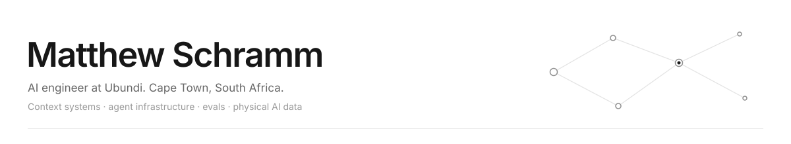

<picture>
  <source media="(max-width: 600px) and (prefers-color-scheme: dark)" srcset="assets/header-mobile-dark.svg" />
  <source media="(max-width: 600px)" srcset="assets/header-mobile-light.svg" />
  <source media="(prefers-color-scheme: dark)" srcset="assets/header-dark.svg" />
  
</picture>

**[Portfolio](https://www.mattschramm.com)** &nbsp;·&nbsp; **[LinkedIn](https://www.linkedin.com/in/matthew-schramm-476523253/)** &nbsp;·&nbsp; **[me@mattschramm.com](mailto:me@mattschramm.com)**

# I build the systems around AI.

The context an agent needs, the memory it retrieves, the checks that prove it worked, and the product a person can use.

I'm **Matthew**, a Graduate AI Engineer at [Ubundi](https://ubundi.com/) in Cape Town. I work across product, engineering, and deployment. I take an unclear idea to working software, then stay with it through releases, customer setup, and daily use.

## Now

**Ayda — company knowledge that agents can use.** 
My main focus. Ayda is an AI assistant that answers from a company's own knowledge, cites its sources, and respects each person's access. I manage releases and hosting for six company deployments, build connectors, and help customers get to their first useful answer.

**Agents and memory — context that lasts beyond a chat.** 
I built Cortex, a long-term memory system for agents. It combines structured facts, a knowledge graph, and several retrieval methods. I also build deployment tools and integrations, and I keep company agents running. I run my own agents every day; that is how I learn where these systems fail.

**First Motive — robot demonstrations into usable datasets.** 
I built data processing, quality checks, annotation, and storage workflows for robot and human recordings. Now I process and improve robot demonstration data: review, provenance, and checked datasets for the team's training workflow.

## Selected projects

| Project | What it does | Built with |
| :-- | :-- | :-- |
| [**Atrium**](https://github.com/Schramm2/Atrium) | A macOS workspace for meetings, notes, and company context. On-device transcription and dictation, with explicit control of each external AI request. | macOS · local models |
| [**ProjectForge**](https://github.com/Schramm2/projectforge) | A CLI that turns requirements and team conventions into verified Python and TypeScript projects through coding agents. | Python · Claude Code · Codex |
| [**Umbono**](https://github.com/Schramm2/umbono-dashboard) | Run one prompt across many models. Compare latency, tokens, and cost, and rank the outputs with a weighted human rubric. | TypeScript |
| [**Resonate**](https://github.com/Schramm2/resonate-showcase) | Models a person's communication style, transforms text, and shows each correction. Deterministic demo with synthetic data. | TypeScript |
| [**Personal Codex**](https://github.com/Schramm2/personal-codex-agent-showcase) | A personal RAG interface with response modes, document workflows, and source attribution. Deterministic demo with synthetic data. | TypeScript |
| [**Local Context Engine**](https://github.com/Schramm2/Local-Context-Engine) | Chat with your PDFs fully offline through Llama 3.2. A feedback loop records each hallucination. | Python · Ollama · Streamlit |
| [**MyAdvisor**](https://github.com/Schramm2/CS-Capstone-Project) | My UCT capstone, built with two teammates: a role-based academic advising and booking platform. | Java · Spring Boot · MySQL |

## How I work

- **Use AI fully. Keep human judgment.** I use Claude Code, Codex, and my own agents to explore and build. The result stays my responsibility.
- **Make the evidence visible.** Sources, evaluation results, data provenance, and repeatable checks belong in the workflow.
- **Follow through.** A feature also needs a release, a usable interface, and a person who can operate it.

## Toolkit

- **Build:** Python, TypeScript, React / Next.js, PostgreSQL, APIs
- **AI:** agents, MCP, retrieval, memory, evaluations, OpenAI, Anthropic, AWS Bedrock
- **Ship:** AWS, Terraform, Docker, CI/CD, OAuth integrations
- **Robot data:** ROS 2, MCAP, LeRobot datasets, SmolVLA data preparation

<!-- cool-readme:start -->
<!-- cool-readme:end -->

## Beyond the code

I studied Computer Science and Information Systems at **UCT**, then completed **Information Systems Honours with distinction**. My thesis examined why young people share data online when they have privacy concerns.

I also tutor as a volunteer in **Langa**, where I teach computer skills and beginner coding. When I can explain a subject clearly, I know that I understand it.

My earlier student projects are still here. They show where the work started.

---

**Do you work on agent memory, context systems, evaluations, or robot data?** 
I'd like to compare notes. [Email me](mailto:me@mattschramm.com) or [see more of my work](https://www.mattschramm.com).
